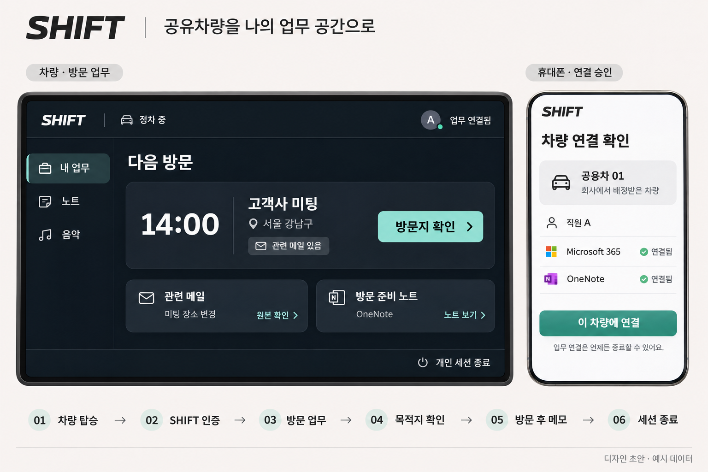

# SHIFT

SHIFT는 공용차를 배정받은 직원이 현대차의 Pleos Connect 차량 화면에서 방문 업무를 확인하고, 목적지를 내비게이션에 보내고, 방문 후 메모를 남기는 차량용 앱입니다.

**배정받은 차량 탑승 → SHIFT 인증 → 내 방문 업무 확인 → 목적지 전달 → 방문 후 메모 → 개인 세션 종료**

차량에서 QR과 PIN으로 인증한 탑승자의 업무가 열립니다. QR로 로그아웃하거나 새 탑승자가 인증하면 기존 차량 세션을 종료합니다. 첫 시제품은 현대 시나리오에 집중하고, A회사·B회사는 조직 확장 예시로 제시합니다. 회사 관리, 차량 등록과 권한 요청, 예약은 후속 개발 항목입니다.

## 기획 문서

- [전체 기획안 v1.1](docs/PLAN.md)
- [결정 기록](docs/DECISIONS.md)
- [공모전 작품 소개 초안](docs/SUBMISSION_DRAFT.md)
- [공식 접수양식에 본문을 넣은 Word 초안](docs/SHIFT_application_draft.docx)

현재는 기획 단계입니다. Word 초안에는 작품 소개 본문이 들어 있습니다. 참가자 정보, 팀명, 전원 동의·서명과 최종 참고자료 링크는 제출 전에 작성합니다.

## 디자인 초안

[첫 디자인 콘셉트와 화면 설명](docs/design/README.md) · [시안 PNG](docs/design/shift-concept-v1.png) · [생성 프롬프트](docs/design/shift-concept-v1.prompt.txt)



## 개발 작업 위치

[rlatmddn0211/SHIFT](https://github.com/rlatmddn0211/SHIFT)의 `app/`에서 차량 앱을 개발합니다. Pleos Connect Emulator 2.1.0의 기본 AVD 프로필은 2560 × 1440 px, 160 dpi, API 34입니다. 실제 시험한 앱 윈도우 규격과 실행 절차는 구현 후 이 README에 기록합니다. [공식 에뮬레이터 가이드](https://document.pleos.ai/docs/connect/guide/getting-started/application-development/setup-connect-sdk-emulator)

## Word 초안 갱신

[공식 접수양식](https://appdevchallenge.auto-hmg.io/downloads/contest-application-consent.docx)을 내려받고 Python과 `lxml`이 있는 환경에서 실행합니다.

```powershell
python tools/build_submission_docx.py '공식양식의 경로.docx'
```

`docs/SUBMISSION_DRAFT.md`의 1~7번 본문을 읽어 Word 초안을 다시 생성합니다. 참가자 정보와 서명은 팀이 작성합니다.
