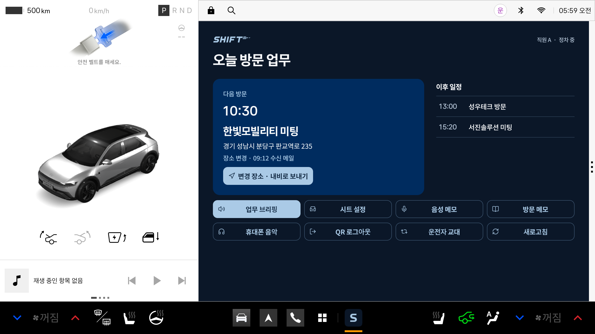
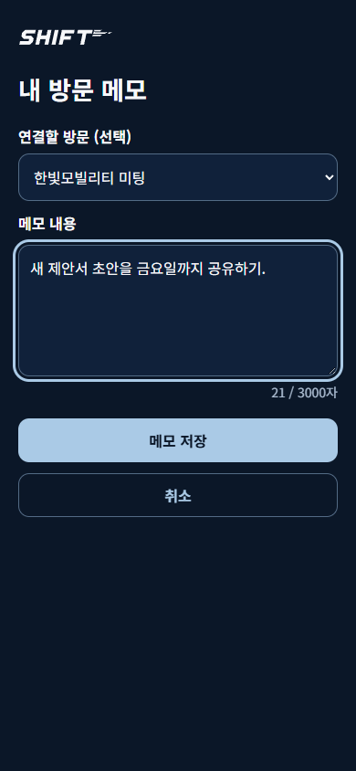
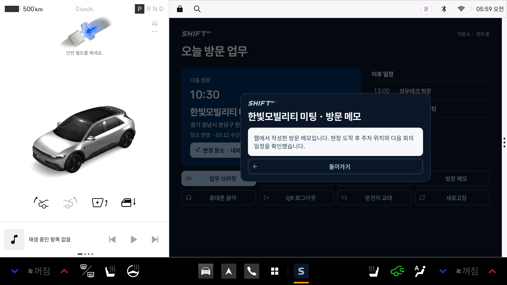

# SHIFT

> **번갈아 타는 회사차, 로그인하면 내 업무 공간.**

SHIFT는 **여러 직원이 번갈아 쓰는 회사 공용차에서, 로그인·로그아웃만으로 각자의 업무 환경을 간편하게 전환하는 차량용 앱**입니다.

직원 A가 로그인하면 A의 일정·메모·개인 설정을 불러옵니다. 이용을 마친 뒤에는 로그아웃하고, 다음 직원 B가 자신의 계정으로 업무 환경을 불러옵니다. 차량에는 **Pleos Connect용 Android 앱**, 휴대폰에는 **모바일 웹**을 사용합니다. Pleos Connect는 차량 화면에서 내비게이션과 여러 앱을 실행하는 현대자동차그룹의 인포테인먼트 시스템입니다.

**[설치 없이 웹으로 체험하기](https://shift-pleos-demo.pages.dev/) · [차량용 APK 다운로드](apk/SHIFT_SHIFT_release.apk?raw=true) · [실제 APK 실행 순서](#apk-run)**

<!-- SHIFT_DEMO_VIDEO: 최종 시연 영상 링크를 이 위치에 추가합니다. -->



*Pleos Connect 에뮬레이터의 실행 화면입니다. 직원과 방문 업무는 시연용 예시 데이터입니다.*

## 어디부터 보면 되나요?

| 하고 싶은 일 | 시작할 곳 | 준비할 것 |
| --- | --- | --- |
| 앱의 사용 흐름을 먼저 보고 싶어요 | [공개 웹 시연](https://shift-pleos-demo.pages.dev/) → **QR·PIN 시연 시작** | 브라우저 |
| 실제 Pleos 앱을 실행하고 싶어요 | [APK 실행 안내](#apk-run) | 개발 PC, Pleos 에뮬레이터, 연동 서버 |
| 휴대폰과 차량의 메모 연동을 확인하고 싶어요 | [대표 시연 순서](#demo-flow) | 위 APK 실행 준비 |
| 코드가 어디에 있는지 알고 싶어요 | [폴더와 소스 읽는 순서](#source-guide) | 이 저장소 |
| Microsoft 365를 실제로 연결하고 싶어요 | [업무 계정 설정](docs/SHIFT_WORKSPACE.md) | 권한을 승인할 수 있는 시험 계정과 Entra 앱 등록 |

**처음에는 웹 시연을 먼저 보고, 실제 구동이 필요할 때 APK 실행 안내를 따라가는 것을 권장합니다.** 휴대폰에는 별도의 SHIFT APK를 설치하지 않고 브라우저로 승인·설정·메모 화면을 엽니다.

[웹 체험](#web-demo) · [APK 받기](#download) · [APK 실행](#apk-run) · [시연 순서](#demo-flow) · [구현·검증 범위](#status) · [소스 안내](#source-guide) · [빌드·테스트](#development) · [문제 해결](#troubleshooting)

<a id="web-demo"></a>
## 설치 없이 웹으로 체험하기

1. **[SHIFT 공개 웹 시연](https://shift-pleos-demo.pages.dev/)**을 엽니다. 넓은 PC 화면을 권장합니다.
2. 소개 화면의 **QR·PIN 시연 시작**을 누릅니다. 차량과 휴대폰 화면이 나란히 나타납니다.
3. 왼쪽 차량 화면의 QR을 누르고, 표시된 **6자리 PIN**을 오른쪽 휴대폰 화면에 입력해 **로그인 승인**합니다.
4. 차량에 **오늘 방문 업무**가 열리는지 확인합니다. 휴대폰의 **내 방문 메모 → 메모 작성**에서 메모를 입력하고 **메모 저장**을 누릅니다.
5. 정차 상태에서 차량의 **방문 메모**를 열어 방금 저장한 제목과 내용을 확인합니다.
6. 차량의 **QR 로그아웃**을 열고 휴대폰에서 승인합니다. 화면 상단에서 **직원 B**를 선택해 다시 인증하면 B의 업무 환경으로 전환됩니다.

**전체 화면** 메뉴에서는 좌석·목적지 전달·음성 메모·오류 상태를 둘러볼 수 있습니다. **다시 시작**은 예시 데이터를 초기화하고, **발표 모드**는 화면 녹화를 위해 검토 도구를 접습니다.

웹 시연의 두 기기 화면은 **한 브라우저 탭에서 예시 상태를 공유**합니다. 실제 휴대폰으로 QR을 스캔하면 해당 기기에 별도 시연이 열립니다. 실제 차량·서버 연결은 아래의 APK 시연으로 확인합니다. 웹 시연을 새로고침하면 예시 데이터가 초기화됩니다.

<a id="download"></a>
## 차량용 APK 받기

| 항목 | 제출 파일 |
| --- | --- |
| 다운로드 | **[SHIFT_SHIFT_release.apk](apk/SHIFT_SHIFT_release.apk?raw=true)** |
| 저장소 내 위치 | `apk/SHIFT_SHIFT_release.apk` |
| 앱 / 패키지 | SHIFT / `com.shift.vehicle` |
| 버전 | `0.2.0` · versionCode `2` |
| 실행 대상 | Pleos Connect 차량 환경. 아래 안내는 **Pleos Connect Emulator 2.1.0** 기준 |
| 서버 접속 주소 | 에뮬레이터에서 `http://10.0.2.2:8787` |

GitHub의 파일 화면이 열리면 **Download raw / 원시 파일 다운로드**를 눌러 받습니다. 현재 제출 대상으로 확인한 차량용 release APK는 위 한 개입니다.

**APK를 실행하려면 연동 서버도 필요합니다.** 차량 앱은 서버에서 QR 승인을 확인하고 해당 직원의 업무·메모를 읽습니다. 휴대폰 승인 페이지도 같은 서버가 제공합니다.

<a id="apk-run"></a>
<a id="제출용-apk-실행"></a>
## 실제 차량 APK 실행하기

### 1. 준비물과 소스 폴더 확인

| 준비물 | 기준 / 용도 |
| --- | --- |
| Node.js | **24.12 이상**. 연동 서버와 모바일 웹 빌드 |
| Pleos Connect Emulator | **2.1.0**. 공식 가이드로 설치·실행 |
| Android SDK Platform-Tools | APK 설치에 사용하는 `adb` |
| 이 저장소의 소스 | `app/`, `server/`, `webapp/`, `apk/`가 있는 버전 |

[Node.js 다운로드](https://nodejs.org/en/download) · [Pleos 에뮬레이터 준비 안내](https://document.pleos.ai/docs/connect/guide/getting-started/application-development/setup-connect-sdk-emulator) · [Android Platform-Tools](https://developer.android.com/tools/releases/platform-tools)

GitHub에서 **현재 읽고 있는 README와 같은 브랜치**를 연 상태로 **Code → Download ZIP**을 누르면 해당 버전의 소스를 받을 수 있습니다. 압축을 풀고 **`README.md`와 `server/` 폴더가 함께 있는 최상위 폴더**에서 터미널을 엽니다.

이후 명령은 그 최상위 폴더에서 실행합니다. Windows PowerShell 예시이며, macOS·Linux에서는 `npm.cmd` 대신 `npm`을 사용합니다. 서명된 APK를 그대로 설치하는 데에는 Android 소스 빌드가 필요하지 않습니다.

### 2. 개발 PC에서 연동 서버 실행

```powershell
npm.cmd --prefix webapp ci
npm.cmd --prefix webapp run build
npm.cmd --prefix server start
```

다음 로그가 나오면 서버가 시작된 것입니다. **이 터미널은 열어 둡니다.**

```text
SHIFT demo server listening on 127.0.0.1:8787
```

개발 PC에서 `http://127.0.0.1:8787/health`를 열어 `{"ok":true}`가 표시되는지 확인할 수 있습니다.

| 접속하는 곳 | 주소 |
| --- | --- |
| 개발 PC에서 실행되는 서버 | `http://127.0.0.1:8787` |
| Pleos 에뮬레이터에서 같은 서버에 접속 | `http://10.0.2.2:8787` |
| 직원이 여는 승인 페이지 | 차량 QR에 들어 있는 `/approve/...` 주소 |

`10.0.2.2`는 Android 에뮬레이터에서 개발 PC에 접속할 때 사용하는 주소입니다. [공식 에뮬레이터 네트워크 안내](https://developer.android.com/studio/run/emulator-networking-address)

### 3. Pleos 에뮬레이터에 APK 설치

Pleos Connect Emulator를 실행하고 **P(주차)** 상태로 둡니다. 서버와 별도의 PowerShell 창에서 다음을 실행합니다.

```powershell
# 설치한 Android SDK의 실제 경로로 지정합니다.
$adb = 'C:\Users\YOUR_NAME\AppData\Local\Android\Sdk\platform-tools\adb.exe'

# 연결된 기기·에뮬레이터 목록을 확인합니다.
& $adb devices

# 위 목록에서 Pleos 에뮬레이터의 시리얼을 넣습니다.
$pleosSerial = 'emulator-5554'
$carUser = (& $adb -s $pleosSerial shell am get-current-user).Trim()

& $adb -s $pleosSerial install -r --user $carUser .\apk\SHIFT_SHIFT_release.apk
& $adb -s $pleosSerial shell am start --user $carUser -n com.shift.vehicle/.MainActivity
```

설치 명령에 `Success`가 표시되고, 에뮬레이터에서 SHIFT의 **공용차 로그인** 화면에 QR과 PIN이 나타나면 준비가 끝났습니다. `emulator-5554`는 예시이므로 실제 시리얼을 사용합니다. Android Studio의 SDK Manager에서 Android SDK 경로를 확인할 수 있습니다.

### 4. 개발 PC 브라우저로 로그인 승인

1. 휴대폰 카메라 등으로 **실행 중인 차량 화면의 QR**을 읽고 링크 주소를 복사해 **개발 PC 브라우저**에서 엽니다. PC로 승인할 때는 휴대폰에서 페이지를 열지 않고 주소만 옮기면 됩니다.
2. **시연 계정 → 직원 A**를 선택하고 차량에 표시된 **6자리 PIN**을 입력합니다.
3. **로그인 승인**을 누릅니다.
4. 차량 화면이 **오늘 방문 업무**로 바뀌고 직원 A의 예시 일정이 표시되는지 확인합니다.

PIN은 **2분 동안 유효**하며, 5회 틀리면 해당 요청이 잠깁니다. 만료되면 차량 화면에서 새 QR·PIN을 발급받습니다. 첫 시연은 Microsoft 계정이나 외부 API 키 없이 A/B 예시 계정으로 할 수 있습니다.

README의 화면 캡처에 있는 QR·PIN은 과거 시연 값입니다. 실제 실행 중인 차량 화면의 현재 QR·PIN을 사용해 주세요.

<details>
<summary>실제 Android 휴대폰으로 QR을 스캔하려면</summary>

USB 디버깅이 허용된 테스트용 Android 휴대폰을 개발 PC에 연결합니다. `adb devices`로 휴대폰 시리얼을 확인한 뒤 다음을 실행합니다.

```powershell
& $adb -s 'PHONE_SERIAL' reverse tcp:8787 tcp:8787
```

이후 휴대폰 카메라로 차량 QR을 스캔합니다. `PHONE_SERIAL`에는 Pleos 에뮬레이터가 아닌 **휴대폰의 시리얼**을 넣습니다. [Android 공식 포트 전달 안내](https://developer.android.com/develop/ui/views/layout/webapps/access-local-server)

현재 남긴 모바일 실행 캡처는 Chrome의 390 × 844 화면을 사용했습니다. 실물 휴대폰 페어링과 차량 오디오 재생은 별도 검증 대상입니다.

</details>

<a id="demo-flow"></a>
## 실제 APK에서 따라 해 볼 대표 순서

| 순서 | 누를 곳 / 할 일 | 확인할 결과 |
| --- | --- | --- |
| 1. 직원 A 로그인 | 차량 QR → 브라우저에서 A 선택·PIN 입력 → **로그인 승인** | 차량에 A의 **오늘 방문 업무** 표시 |
| 2. 업무 환경 준비 | 모바일의 **업무·개인 설정 열기** | 좌석 프로필과 업무 자료 선택 화면 |
| 3. 방문 업무 확인 | 차량에서 다음 방문 선택 | 방문 장소와 변경 근거 확인 |
| 4. 휴대폰 메모 작성 | 브라우저의 **내 방문 메모 → 메모 작성** → 내용 입력 → **메모 저장** | 웹 목록에 저장한 메모 표시 |
| 5. 차량에서 이어 보기 | 주차 상태에서 차량의 **방문 메모** → 메모 제목 선택 | 휴대폰에 쓴 제목과 본문 표시 |
| 6. 직원 A 이용 종료 | 차량의 **QR 로그아웃** → 로그인에 사용한 브라우저에서 **로그아웃 승인** | 차량이 공용 로그인 화면으로 복귀 |
| 7. 직원 B 이용 시작 | 새 QR을 열고 B 선택·새 PIN 승인 | 같은 차량에 B의 업무 환경 표시 |

**핵심은 같은 회사 차량을 다음 직원도 자기 로그인만으로 자신의 업무 환경으로 전환하는 경험입니다.** A/B는 팀이 준비한 가상 사용자와 시험 데이터입니다.

차량에서 **운전자 교대**를 열고 B가 인증하는 직접 전환도 확인할 수 있습니다. **음성 메모**는 인식한 내용을 검토·저장한 뒤 같은 직원의 휴대폰에서 조회하는 흐름입니다. 음성 입력의 현재 검증 범위는 아래 표를 참고해 주세요.

<details>
<summary>휴대폰 메모 작성과 Pleos 조회 화면 보기</summary>





</details>

<a id="status"></a>
## 현재 구현·검증 범위

| 항목 | 현재 확인한 범위 | 추가로 확인할 부분 |
| --- | --- | --- |
| 인증·로그아웃·교대 | QR·PIN 승인, 요청 만료·재사용 제한, A/B 환경 전환 | 실제 조직 계정과 운영 환경 |
| 휴대폰 ↔ 차량 메모 | 모바일 작성·저장, Pleos 목록·본문 조회, 차량 저장 메모의 모바일 조회 | 실제 OneNote 계정 저장·조회 |
| 내비게이션 | 공식 시험 POI로 기본 내비 안내와 목적지 확인 | 일반 주소의 좌표·POI 매칭 |
| 업무 브리핑 | Pleos 한국어 TTS 완료 응답, AI 요청·동의·오류 대체 코드 | 실제 외부 AI 제공자 연동 |
| 음성 메모 | 시험 PCM 입력의 Pleos STT 인식, 확인 후 시연 메모 저장 | 실제 차량 마이크 입력 |
| 좌석 프로필 | 높이·앞뒤 위치 조회와 이동·정지 명령, 응답 불일치 시 중단 | 목표 위치 도달과 실차 검증 |
| 휴대폰 음악 | 연결 안내와 Pleos Bluetooth 설정 열기 | 실물 페어링과 차량 스피커 재생 |
| Outlook·OneNote | 사용자 위임 인증·Graph 코드와 모의 응답 시험 | 동의한 실제 Microsoft 365 계정 |

현재 시제품은 서버 메모리에 차량 세션을, 로컬 파일에 개인 설정과 시연 메모를 보관합니다. 상세 결과와 각 화면 캡처는 [Pleos SDK별 실행 기록](docs/SHIFT_V12_DEMO.md), 최신 모바일 메모 흐름은 [웹·Pleos 연동 기록](docs/SHIFT_WEBAPP_PLEOS.md)에 있습니다.

### 시험 환경

| 항목 | 확인 환경 |
| --- | --- |
| 차량 | Pleos Connect Emulator **2.1.0**, Android **API 34** |
| 전체 차량 화면 | **2560 × 1440 px**, **160 dpi** |
| 실제 가로 앱 창 | **1682 × 1210 dp** |
| 휴대폰 화면 | Chrome 모바일 뷰포트 **390 × 844** |
| 서버 | Node.js **24.12 이상** |
| APK | `com.shift.vehicle`, **0.2.0**, 서명 release |

<a id="source-guide"></a>
## 폴더와 소스 읽는 순서

| 경로 | 무엇인가요? | 처음 볼 파일 |
| --- | --- | --- |
| [`apk/`](apk/) | 에뮬레이터에 설치할 실행 파일 | [`SHIFT_SHIFT_release.apk`](apk/SHIFT_SHIFT_release.apk?raw=true) |
| [`app/`](app/) | 차량에서 실행하는 Kotlin Android 앱 | [`MainActivity.kt`](app/src/main/java/com/shift/vehicle/MainActivity.kt) |
| [`server/`](server/) | QR 승인·차량 세션·사용자별 업무와 메모 API | [`server.ts`](server/src/server.ts) |
| [`webapp/`](webapp/) | 실제 연동 서버를 사용하는 휴대폰 웹 | [`main.tsx`](webapp/src/main.tsx) |
| [`prototype/`](prototype/) | 설치 없이 체험하는 공개 웹 시연 | [`README.md`](prototype/README.md) |
| [`docs/`](docs/) | 실행 설정, SDK 검증 결과, 화면 캡처 | 아래 상세 문서 세 개 |
| [`gradle/`](gradle/) · `gradlew` · `gradlew.bat` | Android 빌드를 실행하는 Gradle wrapper | [`app/build.gradle.kts`](app/build.gradle.kts) |

차량의 화면 구성은 [`VehicleLoginView.kt`](app/src/main/java/com/shift/vehicle/VehicleLoginView.kt)와 [`VehicleWorkScreen.kt`](app/src/main/java/com/shift/vehicle/VehicleWorkScreen.kt), 업무 흐름은 [`VehicleWorkController.kt`](app/src/main/java/com/shift/vehicle/VehicleWorkController.kt)에서 확인합니다. SDK 연결은 `PleosNavigation.kt`, `PleosSpeech.kt`, `PleosVehicle.kt`로 나뉩니다.

- **[업무 계정·개인 설정](docs/SHIFT_WORKSPACE.md)**: 실제 Microsoft 365 연결, 권한, 저장 위치와 AI 제공자 설정.
- **[모바일 웹·Pleos 연동](docs/SHIFT_WEBAPP_PLEOS.md)**: 메모 작성·조회와 A/B 전환의 실행 기록.
- **[Pleos 기능별 검증](docs/SHIFT_V12_DEMO.md)**: 내비·음성·좌석·음악·주행 상태의 확인 결과와 제한 사항.

<a id="development"></a>
## 개발자를 위한 빌드·테스트

<details>
<summary>Android 앱을 소스에서 빌드하기</summary>

JDK **17 또는 21**, Android SDK **Platform 34**, **Build Tools 35.0.0**이 필요합니다. Android SDK 경로를 `ANDROID_HOME`에 설정하거나 Android Studio에서 프로젝트를 엽니다. Gradle은 저장소의 wrapper를 사용합니다.

```powershell
# 디버그 APK와 lint
.\gradlew.bat '-Pandroid.overridePathCheck=true' :app:assembleDebug :app:lintDebug

# 서명 전 릴리스 APK와 lint
.\gradlew.bat '-Pandroid.overridePathCheck=true' :app:assembleRelease :app:lintRelease
```

`android.overridePathCheck`는 Windows 한글 경로에서 사용하는 옵션입니다. macOS·Linux에서는 `./gradlew :app:assembleDebug :app:lintDebug`로 실행합니다. 디버그 결과물은 `app/build/outputs/apk/debug/app-debug.apk`에 생성됩니다.

릴리스 빌드의 기본 서버 주소는 `http://10.0.2.2:8787`입니다. 다른 운영 서버를 쓰려면 빌드할 때 `-PshiftReleaseApiOrigin=https://서버주소`를 지정합니다. 직접 빌드한 릴리스 APK에는 별도의 서명이 필요하며, 저장소의 제출용 APK는 이미 서명돼 있습니다.

</details>

<details>
<summary>서버 테스트 실행하기</summary>

```powershell
npm.cmd --prefix server test
```

QR·PIN 만료, 입력 제한, 중복 승인, 로그아웃과 교대, 메모 저장·재시도·사용자 분리, Microsoft 인증과 외부 응답 처리를 검사합니다. 실제 Microsoft 계정 응답은 모의 응답으로 검증합니다.

</details>

<details>
<summary>공개 웹 시연을 로컬에서 실행하기</summary>

```powershell
npm.cmd --prefix prototype ci
npm.cmd --prefix prototype run dev
```

같은 PC의 브라우저에서 **http://127.0.0.1:5173/**을 엽니다. 배포용 빌드는 다음과 같습니다.

```powershell
npm.cmd --prefix prototype run build
```

기존 Playwright 테스트로 웹 시연을 확인하려면 다음을 실행합니다.

```powershell
npm.cmd --prefix prototype exec -- playwright install chromium --only-shell
npm.cmd --prefix prototype run test:e2e
```

</details>

<a id="troubleshooting"></a>
## 실행 중 막혔을 때

| 증상 | 확인할 것 |
| --- | --- |
| APK를 PC에서 열었는데 앱이 실행되지 않아요 | 차량용 APK는 Pleos 에뮬레이터에 설치합니다. 브라우저로 바로 보려면 상단의 공개 웹 시연을 이용합니다. |
| APK에서 서버 연결에 실패해요 | 개발 PC의 서버 터미널이 켜져 있는지, 서버가 `8787`에서 실행 중인지 확인합니다. APK는 `10.0.2.2:8787`로 접속합니다. |
| `127.0.0.1:8787`을 열었더니 `not_found`가 나와요 | 승인 페이지는 차량 QR의 `/approve/...` 주소에서 열립니다. QR의 전체 주소로 접속하세요. |
| PIN이 맞지 않거나 만료됐어요 | 차량에서 새 QR·PIN을 발급받고 현재 화면의 6자리를 입력합니다. 이전 PIN은 사용할 수 없습니다. |
| 메모 작성 버튼이 없어요 | 실제 Microsoft 계정은 OneNote 권한이 필요합니다. 먼저 A/B 예시 계정으로 시연하거나 [계정 설정](docs/SHIFT_WORKSPACE.md)을 확인합니다. |
| 주행 중 버튼이 안 보여요 | 상세 업무·좌석·메모 등 주차 전용 기능은 **P(주차)** 상태에서 확인합니다. |
| APK 설치 시 서명 충돌 오류가 나요 | 다른 키로 서명한 앱과 충돌할 수 있습니다. 제출 APK는 별도의 Pleos AVD에서 설치해 확인합니다. |
| PC 브라우저에서는 QR이 열리지만 휴대폰에서는 안 열려요 | 기본 QR 주소는 개발 PC의 localhost 기준입니다. 위 Android 휴대폰 포트 전달 안내를 따라 주세요. |
| 원격 PC에서 웹 서버를 켰는데 Mac의 localhost에서 안 열려요 | 브라우저의 localhost는 그 Mac을 뜻합니다. 아래 SSH 포트 전달 예시를 사용합니다. |

<details>
<summary>SSH로 접속 중인 Mac에서 로컬 웹 시연 열기</summary>

**Mac 자체의 새 터미널 창**에서 아래 명령을 실행합니다. 계정과 개발 PC 주소는 현재 사용하는 SSH 접속 정보로 바꿉니다.

```bash
ssh -N -L 127.0.0.1:15173:127.0.0.1:5173 SSH_ACCOUNT@DEV_PC_ADDRESS
```

연결한 터미널을 열어 둔 상태에서 Mac 브라우저로 **http://127.0.0.1:15173/**에 접속합니다. 원격 PC에서는 `prototype`의 개발 서버가 계속 실행 중이어야 합니다. 실제 차량 연동 서버의 `8787`과 웹 시연의 `5173`은 용도가 다릅니다.

</details>

## 개발 환경 참고

[공식 공모전 제출 안내](https://appdevchallenge.auto-hmg.io/guide/submission) · [Pleos Connect 개발 문서](https://document.pleos.ai/docs/connect/guide/connect) · [Pleos 에뮬레이터 가이드](https://document.pleos.ai/docs/connect/guide/getting-started/application-development/setup-connect-sdk-emulator)
