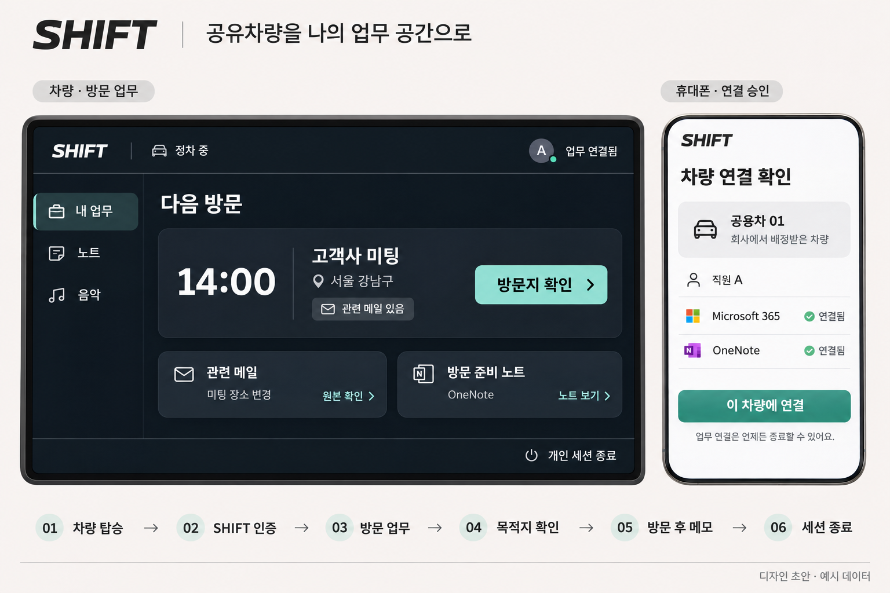

# SHIFT 디자인 초안 v1

확정한 방문 업무 흐름과 짙은 차량 화면·밝은 휴대폰 화면을 바탕으로 만든 첫 정적 콘셉트다. 기본 제공 이미지 생성 도구 `image_gen`을 사용했다. [원본 생성 프롬프트](shift-concept-v1.prompt.txt)를 함께 보관한다.

## 이번에 표현한 화면

- 왼쪽 차량 화면은 다음 방문 일정과 방문지 확인을 가장 크게 보여주는 업무 홈이다. 관련 메일과 OneNote는 방문 준비를 돕는 보조 정보로 배치했다.
- 오른쪽 휴대폰 화면은 현재 차량과 계정을 확인하고 업무 연결을 승인하는 단계다. 두 화면은 각 단계의 대표 레이아웃을 보여준다.
- 하단에는 차량 탑승, 인증, 방문 업무, 목적지 확인, 방문 후 메모, 세션 종료의 여섯 단계를 표시했다.

사내 차량 관리·예약·반납 UI는 포함하지 않았다. 음악 메뉴는 보조 기능의 진입점이며, 검증되지 않은 YouTube Music 재생목록·플레이어 화면을 표현하지 않았다. 화면의 계정·일정·연결 표시는 예시 데이터다.

## 다음 시안에서 구체화할 부분

QR·PIN 입력과 로그아웃 승인, 목적지 후보·근거 확인, 음성 메모 확인·저장, A/B 전환 결과 화면을 이어서 설계한다. 최신 기획안의 인증·종료 정책과 맞추고 실제 Pleos 시스템 영역·앱 윈도우 규격을 적용한다.

이 파일은 화면 톤과 정보 우선순위를 검토할 이미지이며, 실행 가능한 앱이나 편집 가능한 Figma 원본은 아니다. 실제 SDK·Microsoft 연동 완료를 뜻하지 않는다.
