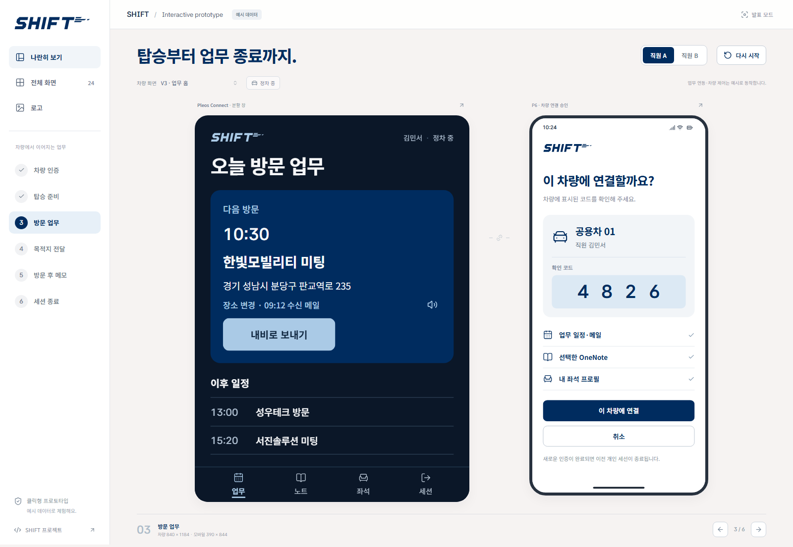

# SHIFT 디자인·웹 프로토타입 v2

친구가 확정한 [Pleos 분할 창 시안](https://github.com/rlatmddn0211/SHIFT/blob/codex/pleos-screen-dev/docs/images/shift-pleos-compact.png)을 기준으로 만든 클릭형 웹 프로토타입과 화면·로고 에셋입니다. 참고 이미지의 Git blob SHA는 `377d8a679f58816305fc6d25b7f51c0a4828209a`입니다.

[웹 프로토타입 실행 안내](../../../prototype/README.md) · [화면 정의 JSON](screen-manifest.json) · [전체 화면 미리보기](gallery.png)

## 로고

두꺼운 글자, 앞으로 기운 형태와 오른쪽 스피드 조각을 직접 벡터로 구성했습니다. 기본색은 Hyundai Blue `#002C5F`입니다.

- [남색 SVG](shift-wordmark.svg)
- [남색 투명 PNG · 2560 × 448](SHIFT-wordmark-hyundai-blue.png)
- [흰색 SVG](shift-wordmark-white.svg)
- [로고·색상 적용 미리보기](brand.png)

SVG는 글자를 경로로 구성하므로 별도 폰트가 없어도 형태가 유지됩니다. 앱 안의 로고 화면에서도 SVG·PNG를 내려받을 수 있습니다.

## 화면 목록

기본 화면 16개와 상태 8개입니다. S7에는 저장 성공과 실패·재시도 변형이 있고, 주행 상태와 직원 A/B도 웹 안에서 바꿀 수 있습니다.

| ID | 화면 PNG | 규격 |
| --- | --- | --- |
| V1 | [시작·QR 인증](screens/V1.png) | 840 × 1184 |
| V2 | [탑승 준비](screens/V2.png) | 840 × 1184 |
| V3 | [업무 홈](screens/V3.png) | 840 × 1184 |
| V4 | [방문 업무 상세](screens/V4.png) | 840 × 1184 |
| V5 | [목적지 확인·전달](screens/V5.png) | 840 × 1184 |
| V6 | [내 노트 조회](screens/V6.png) | 840 × 1184 |
| V7 | [방문 후 음성 메모](screens/V7.png) | 840 × 1184 |
| V8 | [좌석 프로필](screens/V8.png) | 840 × 1184 |
| V9 | [개인 세션 종료](screens/V9.png) | 840 × 1184 |
| P1 | [시작·Microsoft 로그인](screens/P1.png) | 390 × 844 |
| P2 | [내 SHIFT 홈](screens/P2.png) | 390 × 844 |
| P3 | [업무 연결·브리핑 설정](screens/P3.png) | 390 × 844 |
| P4 | [OneNote 선택](screens/P4.png) | 390 × 844 |
| P5 | [좌석 프로필 관리](screens/P5.png) | 390 × 844 |
| P6 | [차량 연결 승인](screens/P6.png) | 390 × 844 |
| P7 | [개인 세션 종료 승인](screens/P7.png) | 390 × 844 |
| S1 | [QR 만료·인증 오류](screens/S1.png) | 840 × 1184 |
| S2 | [개인 환경 불러오기](screens/S2.png) | 840 × 1184 |
| S3 | [업무 미연결·조회 실패](screens/S3.png) | 840 × 1184 |
| S4 | [좌석 미지원](screens/S4.png) | 840 × 1184 |
| S5 | [목적지 전달 실패](screens/S5.png) | 840 × 1184 |
| S6 | [음성 메모 확인](screens/S6.png) | 840 × 1184 |
| S7 | [메모 저장 결과·재시도](screens/S7.png) | 840 × 1184 |
| S8 | [세션 잠금·교대](screens/S8.png) | 840 × 1184 |

차량 이미지는 SHIFT 앱의 분할 윈도우를 나타냅니다. 전체 차량 디스플레이 목업과 구분합니다.

## 참고와 구현

- [기준 시안 PNG](pleos-reference.png)
- [전체 화면 콘셉트](web-concept.png) · [생성 프롬프트](web-concept.prompt.txt)
- [프런트엔드 소스](../../../prototype/src)
- [실행·검증·모의 연동 범위](../../../prototype/README.md)

콘셉트는 내장 image_gen으로 생성했고, 실제 화면과 로고는 React·CSS·SVG로 작성했습니다. UI 전체를 이미지로 덮지 않고 버튼·입력·노트·슬라이더를 실제 요소로 구성했습니다. Figma 작업은 사용자 선택에 따라 웹 프로토타입으로 전환했으며 새 Figma 파일은 만들지 않았습니다.
